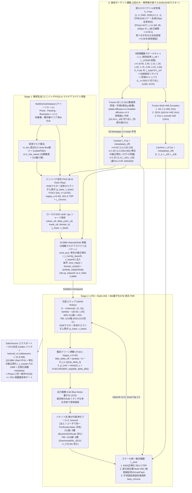
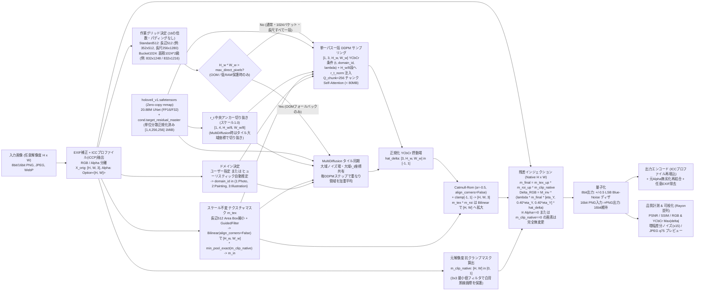

# `holoveil` 詳細技術設計書 (Architecture & Engineering Specification)

> **Version**: `0.5.3-design` (Post-Review Hardened Implementation Baseline)  
> **Target Runtime Stack**: Pure Rust (`candle-core` / `candle-nn` + `eframe` / `egui`)  
> **Training Stack**: Python + PyTorch (`SafeTensors` 単一ファイル境界)  
> **Scope**: 本書は、元論文や過去の経緯を参照せずとも **本書単体で Phase 0a/0b/0c（PoC & 早期蒸留検証）〜 Phase 3（OSS リリース）まで一気通貫で実装・検証できる完全自己完結仕様書** である。

---

## 0. プロダクト目標・理論基盤・正直な適用範囲

### 0.1 プロダクト目標

`holoveil` は、イラストレーター・写真家・一般ユーザーが SNS やポートフォリオへ画像を公開する前に、ローカル環境で以下を両立して付与する OSS デスクトップ／CLI アプリケーションである。

1. **肉眼での不可視性（特にアニメ調・ベタ塗りデジタルイラスト・白背景線画を含む）**:
   - YCbCr 色空間での色差バジェット固定制限（$\kappa_c = 0.40$）、固定長辺 512 基準の Guided Filter によるテクスチャマスク $m_{\text{tex}}$、**元解像度での画素単位抗クランプ減衰マスク $m_{\text{clip\_native}}$**（3×3 最小値フィルタ付き）、平坦部低周波色差ペナルティ、8-bit Blue-noise ディザリング、ICC カラープロファイル（`iCCP`）保持を統合し、ベタ塗り色ムラ・線画沿いの灰色縁取り・8-bit バンディングを構造的に排除する。
2. **無断学習・模倣（LoRA / DreamBooth / 抽出パイプライン）への実用的な阻害力**:
   - 推論時の重い画像別逆伝播（PGD）を廃し、事前学習した **20.88M Pixel-Space Conditional Diffusion U-Net** による 5〜50 ステップ（推奨 10〜25 ステップ）の高速サンプリングで保護摂動を生成する。
   - U-Net の $H_w/8 \times W_w/8$ 潜在相当解像度段へ **単位分散正規化済みターゲット残差マップ $\tilde{r}_t$ の切り抜きスライス（`cond_proj`）を空間入力として注入** することで、任意 16 倍数解像度への対応を維持したまま絶対空間位置に紐づく一貫したターゲット方向を確実に生成する。
   - 学習と推論の条件（強度 $\lambda$、色差比 $\kappa_c$、アスペクト比および最大 1216 辺級解像度、出力 8-bit ディザ量子化、知覚マスク $m$、フル `2048×2048` 空間ターゲット座標系）を完全に整合させ、配布する **Stealth プリセット（$\lambda = 0.72$, マスク有効）** 自体を報酬学習で直接最適化する。
3. **現実的な配布性と実行速度**:
   - **CPU 版（Windows / Linux）および Metal 版（macOS Apple Silicon）** は外部 Python ランタイム・C++ 共有ライブラリ不要の **完全シングルバイナリ** とする。
   - **CUDA 版（Windows / Linux NVIDIA GPU）** は高速推論のため `cuDNN` を有効化し、実行に必要な NVIDIA 再配布可能ランタイム（cuDNN / cuBLAS / NVRTC 等）を配布アーカイブに同梱する。

### 0.2 理論基盤の統合設計（本書完結の定式化）

`holoveil` は以下の 3 つの研究知見を単一モデル・単一パスへ統合する。

1. **高速償却型拡散保護 & EMA 正規化 TRP 損失（PDM 由来）**:
   - 凍結サロゲート拡散モデル（SD 1.5）において、保護画像 $X_p$ の潜在表現 $z = \mathcal{E}(X_p)$ に時刻 $\tau$ のノイズ $\epsilon \sim \mathcal{N}(0, I)$ を加えた $z_\tau = \alpha_\tau z + \sigma_\tau \epsilon$ のデノイジング残差を $r_p = \epsilon_{\text{sur}}(z_\tau, \tau, c_{\emptyset}) - \epsilon$ と定義する（$c_{\emptyset}$ は空プロンプト埋め込み）。
   - 攻撃者が LoRA / DreamBooth 等でファインチューニングする際のパラメータ勾配は $\nabla_\theta \mathcal{L}_{\text{ft}}(X_p) = 2 J_\theta(X_p)^\top r_p$ と因数分解される。二乗誤差 $\|r_p - r_t\|_2^2$ は $\|r_p\|_2^2$ 縮小項を含み攻撃者損失を下げてしまうため、全保護画像の残差 $r_p$ を共通ターゲット方向 $r_t$ へ押し出す **Target Residual Projection (TRP) 損失** を採用し、他損失とのスケール整合のため **デタッチ済み移動平均残差ノルム $\bar{N}_r = \text{EMA}(\|r_p\|_2.\text{detach}())$** で正規化する：
     $$\tilde{\mathcal{L}}_{\text{TRP}}(X_p, r_t) = -\frac{\langle r_p, r_t \rangle}{\|r_t\|_2 \cdot (\bar{N}_r + 10^{-8})} = O(1)$$
     *設計ポイント*: 瞬時値の上限は $\|r_p\|_2 / \bar{N}_r$ であり厳密有界ではないが、ステップ間の平均スケールは $O(1)$ に揃う。サンプル単位の $\|r_p\|_2$ で割らないため、線形射影の勾配幾何（$\|r_p\|_2$ 縮小項ゼロ）を 100% 維持する。
   - **空間ターゲット条件付けの必要性**: 畳み込み層は並進同変であり、位置埋め込みを持たない Self-Attention はトークン置換同変であるため、空間的に変化する $r_t(y, x)$ を定数バイアスとして重みへ吸収することは原理的に不可能である。したがって `cond_proj` により、作業グリッドと空間位置を厳密に揃えた単位分散正規化 $\tilde{r}_t$ スライスを U-Net へ明示的に入力する。
   - 学習は 2 段階で構成する：**Stage 1（PGD 教師データからの `v-prediction` 蒸留）** $\to$ **Stage 2（ReFL 風の選択ステップ勾配を用いた Purification-Aware Reward: PAR ポストトレーニング）**。
2. **クロップ＋リサイズ耐性と低周波エネルギー集中（LPID 由来）**:
   - 攻撃者や SNS の「切り抜き＋縮小リサイズ」は、入力・出力解像度の小さい方の半分 $s_0 / 2$ をカットオフ周波数とするローパスフィルタとして働き、通常の高周波摂動を破壊する。
   - Stage 2 の浄化セット内に微分可能クロップ＋バイリニアリサイズ演算子 $T(z) = \text{Resize}_{s_{\text{crop}} \to s_{\text{low}}}^{\text{bilinear, align\_corners=False}}(z[:, y_0:y_0+s_{\text{crop}}, x_0:x_0+s_{\text{crop}}])$ を組み込むことで、減衰する高周波側への勾配が消失し、摂動エネルギーがリサイズ後も生存する低周波帯域 $V$ へ自然に集中する。
   - **低周波エネルギー集中率 $\rho_{\text{LF}}$ の厳密定義**:
     $512 \times 512$ 基準グリッド上の正規化摂動 $\hat{\delta}$ の 2D 離散フーリエ変換 $\mathcal{F}(\hat{\delta})$ に対し、攻撃者の最小リサイズ先 `s_low = 112` のナイキスト限界 $112 / (2 \times 512) \approx 0.1094$ に相当する **半径空間周波数 $f_r(u, v) \le 0.11\text{ cycles/px}$** を低周波帯域 $V$ と固定定義する：
     $$\rho_{\text{LF}} := \frac{\sum_{f_r(u, v) \le 0.11} |\mathcal{F}(\hat{\delta})(u, v)|^2}{\sum_{u, v} |\mathcal{F}(\hat{\delta})(u, v)|^2 + 10^{-8}}$$
   - この低周波集中特性を活かし、U-Net の入力段に `PixelUnshuffle(2)`・出力段に `PixelShuffle(2)` を配置することで最上位解像度での重い畳み込みを廃し、演算量と一時メモリを劇的に削減する。
3. **人間知覚基準・単一パス原則（Glaze / $\text{PDM}^\dagger$ 由来）**:
   - アーティストの実用許容ラインに基づき、推論時の強度スケーリング $\lambda \in [0.60, 1.00]$（モデル条件入力済み）およびサンプリングステップ数 $S \in [5, 50]$ で **Stealth（標準・不可視最優先） / Balanced / Maximum / Custom** を提供する。
   - **単一パス原則（No Double-Cloaking）**: 保護済みの画像へ再度 `holoveil` や他ツールを適用すると一貫したターゲット方向が相殺・破壊されるため、必ず単一統合モデル・1 回のサンプリングで完結させ、UI 上でも二重適用を警告する。

### 0.3 保護の限界に関する正直な開示方針（README / UI 必須記載）

> [!WARNING]
> **適用範囲と限界（Honest Threat Model Disclosure）**  
> Hönig et al. (ICLR 2025, *"Adversarial Perturbations Cannot Reliably Protect Artists From Generative AI"*) 等で報告されている通り、**Noisy Upscaling や拡散モデルによる画像再生成（img2img 浄化）** のような生成的浄化攻撃は、現在知られているあらゆるピクセル空間の不可視摂動保護を大幅に減衰・無効化し得る。  
> `holoveil` の README・リリースノート・GUI ヘルプでは、**Phase 0b および Phase 3 で実測検証したモデル（SD 1.5 / SDXL オリジナル VAE / Flux）および攻撃条件（標準 LoRA/DreamBooth 学習、SNS の JPEG/WebP 再圧縮、クロップ＋リサイズ、0〜64px シフトクロップ）に対する保護効果（YCbCr および RGB $L_\infty$ 換算バジェット併記）のみを明示** し、生成的浄化を含む将来すべての攻撃への完全防御は保証しないことを誠実に明記する。

---

## 1. システム全体アーキテクチャとデータフロー

### 1.1 オフライン学習パイプライン (`trainer/` — Python / PyTorch)



### 1.2 Pure Rust 推論 & 残差インジェクションパイプライン (`holoveil`)



---

## 2. U-Net アーキテクチャ詳細設計（v0.5.2 確定構成）

### 2.1 設計原則

- **空間ダウンサンプリング入力・出力**: 摂動エネルギーが低周波帯域（$\rho_{\text{LF}} \ge 0.88$）に集中する特性を活かし、入力段に `PixelUnshuffle(2)`（$H \times W \to H/2 \times W/2$、7ch $\to$ 28ch）、出力段に `PixelShuffle(2)`（12ch $\to$ 3ch）を配置し、最上位解像度での重い畳み込みを完全に廃止する。
- **Pre-Upsample Conv 配置**: デコーダ各段のアップサンプル用 `Conv2d` を `Nearest 2x` 補間の **前**（低解像度側）に配置し、MAC 演算量と `im2col` 一時メモリを 1/4 に削減する。
- **任意解像度対応の切り抜き型空間ターゲット条件付け (`cond_proj`) と単位分散正規化**:
  - `Down 2`（空間解像度 $H_w/8 \times W_w/8$、SD VAE 潜在空間と完全同解像度・`256 ch`）において、`down.2.res0` の出力へ **単位分散正規化済みマスターターゲット残差 $\tilde{r}_t^{\text{master}} = (r_t^{(1.0)} - \mu_{r_t}) / (\sigma_{r_t} + 10^{-8})$（`[1, 4, 256, 256]`、F32 で 1.00 MiB）** から切り抜いた `r_t_crop`（`[B, 4, H_w/8, W_w/8]`）をチャンネル結合（`256 + 4 = 260 ch`）し、1×1 畳み込み `cond_proj: Conv2d(260, 256, k=1, p=0)` で射影して `down.2.res1` へ渡す。
  - **単位分散正規化の理由と整合**: 生の $r_t$ は振幅が小さいため、そのまま結合すると `down.2.res0`（GroupNorm 後で単位分散）の特徴量に埋もれて学習初期に無視されやすい。学習・エクスポート・推論の全工程で同一の正規化係数（`rt_norm_mean`, `rt_norm_std` を `SafeTensors` `__metadata__` に記録し、`cond.target_residual_master` 自体を単位分散正規化済み F32 テンソルとして格納、ロード時に $|\text{std} - 1.0| < 10^{-3}$ を検証）を使用する。
  - **推論時の切り抜き基準点（中央アンカー）とアスペクト比混在時の性質**:
    - 作業グリッド $(H_w, W_w)$ の潜在寸法 $(h_{\text{lat}}, w_{\text{lat}}) = (H_w/8, W_w/8)$ に対し、256×256 マスターの **中央アンカー** $y_c = \lfloor(256 - h_{\text{lat}})/2\rfloor,\ x_c = \lfloor(256 - w_{\text{lat}})/2\rfloor$ から切り抜く（学習時は 2048 マスター全体からランダム原点を取るため、推論の中央切り抜き範囲は `512²` も `832×1216` も 100% 学習分布内となる）。超巨大パノラマ等で 256 を超える軸が発生した場合のみミラー折り返し参照とする。OOM フォールバックの MultiDiffusion タイル時は各タイルの大域座標 $(y_c + y_k/8, x_c + x_k/8)$ を使用する。
    - *中央アンカーの幾何学的性質（仕様明記）*: 中央アンカーは kohya 等のアスペクト比バケットの中央クロップと整合する一方、**同一の LoRA 学習データセット内に異なるアスペクト比（例: `512×512` と `352×512`）が混在すると、画像の中心同士は揃うが短辺側で最大約 10 潜在画素（≈ 80px）の相対位置ズレが生じる**。このズレを吸収するために、セクション 5.2 で定義する $r_t$ の長い空間自己相関と Phase 0b のシフト耐性検証を必須とする。
- **スカラー条件埋め込み（時刻 $t$・ドメイン $d$・強度 $\lambda$）**:
  - `cond_emb = time_mlp(t) + domain_emb(d) + lambda_mlp(λ)`（`[B, 256]`）を全 `ResBlock` へ注入する（`lambda_mlp.fc2` はゼロ初期化）。
- **チャンク化 Self-Attention（`Q_chunk = 256`）**:
  - トークン数 $L = (H_w/16)(W_w/16) > 1024$ のとき Query ブロックサイズ `256` で分割計算（Softmax は明示的 `F32`）。最大 `max_direct_pixels = 1,150,000`（$L \approx 4,492$）でもスコア行列 `35.1 MiB`・Attention 総作業メモリ **`< 80 MB`** を保証する。

### 2.2 全レイヤーのテンソル形状・演算量・パラメータ数・`SafeTensors` キー一覧

以下は基準解像度 $512 \times 512$ での数値である。全 `GroupNorm` は **`num_groups = 32, eps = 1e-5, affine = True`** とする。

| ブロック | 空間解像度 ($512^2$ 基準) | 入力形状 $\to$ 出力形状 | 内部演算構成 | `SafeTensors` キー接頭辞 | パラメータ数 | GMAC / step |
| :--- | :---: | :---: | :--- | :--- | ---: | ---: |
| **Time + Domain + $\lambda$ Emb** | — | `t, d, λ:[B]` $\to$ `[B, 256]` | `Sin(64)->MLP(256)` + `Emb(4,256)` + `Sin(32)->MLP(256)` | `time_mlp.{fc1,fc2}`, `domain_emb.weight`, `lambda_mlp.{fc1,fc2}` | 157.7 K | 0.00 |
| **Input Space-to-Depth** | $H \to H/2$ ($512 \to 256$) | `[B, 7, H, W]` $\to$ `[B, 28, H/2, W/2]` | `PixelUnshuffle(2)` (`cat([δ_s, x_ycbcr, m_in])`) | — | 0 | 0.00 |
| **Stem** | $H/2$ ($256$) | `[B, 28, 256, 256]` $\to$ `[B, 64, 256, 256]` | `Conv2d(28, 64, k=3, s=1, p=1)` | `conv_in.{weight,bias}` | 16.2 K | 1.06 |
| **Down 0** | $H/2 \to H/4$ ($256 \to 128$) | `64` $\to$ `skip0(64@256)` / `128@128` | `ResBlock(64->64)` + `Conv2d(64, 128, k=3, s=2, p=1)` | `down.0.res.*`, `down.0.downsample.*` | 164.4 K | 6.04 |
| **Down 1** | $H/4 \to H/8$ ($128 \to 64$) | `128` $\to$ `skip1(128@128)` / `256@64` | `ResBlock(128->128)` + `Conv2d(128, 256, k=3, s=2, p=1)` | `down.1.res.*`, `down.1.downsample.*` | 0.62 M | 6.04 |
| **Down 2 + $\tilde{r}_t$ Crop** | $H/8 \to H/16$ ($64 \to 32$) | `256` $\to$ `cat(256, r_t[4])` $\to$ `skip2(256@64)` / `512@32` | `ResBlock(256)` $\to$ `cat(r_t_norm_crop)` $\to$ `Conv2d(260,256,k=1)` $\to$ `ResBlock(256)` + `Conv2d(256,512,k=3,s=2,p=1)` | `down.2.res0.*`, `cond_proj.{weight,bias}`, `down.2.res1.*`, `down.2.downsample.*` | 3.74 M | 11.14 |
| **Middle** | $H/16$ ($32$) | `[B, 512, 32, 32]` $\to$ `[B, 512, 32, 32]` | `ResBlock(512)` $\to$ `SelfAttn2d(512, heads=8, dim=64)` $\to$ `ResBlock(512)` | `mid.{res1,attn,res2}.*` | 10.76 M | 11.81 |
| **Up 2 (Pre-Up, 2×Res)** | $H/16 \to H/8$ ($32 \to 64$) | `512@32` + `skip2(256@64)` $\to$ `256@64` | `Conv2d(512,256,k=3@32)` $\to$ `Nearest2x(@64)` $\to$ `cat(512)` $\to$ `2×ResBlock` | `up.2.upsample.*`, `up.2.{res0,res1}.*` | 4.40 M | 13.82 |
| **Up 1 (Pre-Up)** | $H/8 \to H/4$ ($64 \to 128$) | `256@64` + `skip1(128@128)` $\to$ `128@128` | `Conv2d(256,128,k=3@64)` $\to$ `Nearest2x(@128)` $\to$ `cat(256)` $\to$ `ResBlock(256->128)` | `up.1.upsample.*`, `up.1.res.*` | 0.80 M | 8.99 |
| **Up 0 (Pre-Up)** | $H/4 \to H/2$ ($128 \to 256$) | `128@128` + `skip0(64@256)` $\to$ `64@256` | `Conv2d(128,64,k=3@128)` $\to$ `Nearest2x(@256)` $\to$ `cat(128)` $\to$ `ResBlock(128->64)` | `up.0.upsample.*`, `up.0.res.*` | 209.6 K | 8.99 |
| **Output Head** | $H/2 \to H$ ($256 \to 512$) | `[B, 64, 256, 256]` $\to$ `[B, 3, 512, 512]` | `GroupNorm(32,64)` $\to$ `SiLU` $\to$ `Conv2d(64,12,k=3,p=1)` (ゼロ初期化) $\to$ `PixelShuffle(2)` | `norm_out.{weight,bias}`, `conv_out.{weight,bias}` | 7.1 K | 0.45 |
| **合計** | — | — | **総パラメータ: 20,877,516 (FP16 41.76 MB) + `cond.target_residual_master` (F32 1.00 MiB)** | — | **20.88 M** | **68.35** |

#### サブブロック内部キー規約・メモリ配置・計算量見込み
- **`ResBlock` (`<prefix>.*`)**: `norm1.{weight,bias}`, `conv1.{weight,bias}`, `time_proj.{weight,bias}`（`SiLU(cond_emb)` を入力し加算）, `norm2.{weight,bias}`, `conv2.{weight,bias}`, `skip_conv.{weight,bias}`（`in_ch != out_ch` のみ）。
- **`SelfAttention2d` (`mid.attn.*`)**: `norm.{weight,bias}`, `qkv.{weight,bias}` (`512 -> 1536`), `proj.{weight,bias}` (`512 -> 512`)、スケール $1/\sqrt{64} = 0.125$、Softmax は明示的 `F32`、$L > 1024$ 時は `Q_chunk = 256` でチャンク実行。
- **`PixelUnshuffle(2)` / `PixelShuffle(2)`（Candle 変形順）**:
  - `PixelUnshuffle(2)`: `[B, C, H, W]` $\to$ `reshape([B, C, H/2, 2, W/2, 2])` $\to$ `permute([0, 1, 3, 5, 2, 4])` $\to$ `contiguous()` $\to$ `reshape([B, C*4, H/2, W/2])`
  - `PixelShuffle(2)`: `[B, C*4, H/2, W/2]` $\to$ `reshape([B, C, 2, 2, H/2, W/2])` $\to$ `permute([0, 1, 4, 2, 5, 3])` $\to$ `contiguous()` $\to$ `reshape([B, C, H, W])`
- **一括推論の演算量・CPU F32 ピークメモリ目標**:
  - `Standard512` (`512×512`): `68.35 GMAC/step`、ピーク `im2col` **288 MB**、プロセス総 RSS 目標 **`< 700 MB`**。CPU 約 18〜30 秒（25 steps）/ 7〜12 秒（10 steps）、Metal 約 1.5〜3.5 秒、CUDA+cuDNN 約 0.4〜1.0 秒。
  - `Standard512` 縦長 (`352×512`): `47.0 GMAC/step`、ピーク `im2col` **198 MB**。
  - 長尺一括 (`256×1280`): `85.4 GMAC/step`、ピーク `im2col` **360 MB**（タイル不要）。
  - `Bucket1024` 一括 (`832×1248` / `832×1216`): 約 `264〜271 GMAC/step`（`0.53〜0.54 TFLOP/step`）、ピーク `im2col` **約 1.11〜1.14 GB**、プロセス総 RSS 目標 **`< 2.4 GB`**（`mimalloc` 採用推奨）。CPU 25 steps 約 70〜120 秒 / 10 steps 約 28〜48 秒、CUDA+cuDNN 約 1.5〜3 秒。

> [!NOTE]
> **`PixelShuffle(2)` 由来の 2×2 格子模様（チェッカーボード）対策と監視**  
> `PixelShuffle(2)` は学習時に 512 スケールで周期 2px（3000px 拡大時に約 12px 格子）の高調波ピークを生むリスクがある。Phase 2 の検証ループおよび Phase 3 ベンチマークでは、非正方形リサイズによるビン移動で見逃さないよう、**作業グリッド原生解像度 $(H_w, W_w)$ 上の生成摂動 $\hat{\delta}$ の 2D FFT パワースペクトル（特に `(H_w//2, W_w//2)` 等の $f = 0.5\text{ cycles/px}$ 成分）** のエネルギー比を必ず自動監視し、ピーク発生時は `conv_out` の ICNR 初期化または微小な 2×2 隣接差分正則化を適用する。

---

## 3. 肉眼不可視性・色空間・厳密リサンプリング・任意解像度インジェクション仕様

**PyTorch（Phase 0 / Phase 2）と Pure Rust（Phase 1 / 製品）は本節のすべての数式・リサンプリングカーネル・定数を 100% 同一に実装する。**

### 3.1 YCbCr 色空間での摂動制御（$\kappa_c = 0.40$ 固定）と RGB $L_\infty$ 換算明記

色差比 $\kappa_c$ を推論時に変更すると RGB 空間での摂動ベクトル方向が回転し、学習済み敵対方向とズレが生じる。そのため **全学習および全標準プリセットにおいて $\kappa_c = 0.40$ を固定** し、可視性・強度の調整はモデルに条件入力される $\lambda$ と知覚マスク $m$ で一貫制御する。

- **ITU-R BT.601 Full-Range 変換**（$R, G, B \in [0, 1]$）:
  $$\begin{bmatrix} Y \\ Cb \\ Cr \end{bmatrix} = \begin{bmatrix} 0.299000 & 0.587000 & 0.114000 \\ -0.168736 & -0.331264 & 0.500000 \\ 0.500000 & -0.418688 & -0.081312 \end{bmatrix} \begin{bmatrix} R \\ G \\ B \end{bmatrix}, \quad X_{\text{net}} = (2Y - 1,\ 2Cb,\ 2Cr) \in [-1, 1]^3$$
- **逆変換行列 $M_{\text{inv}}$ と摂動加算**:
  $$\eta_Y = \frac{12.0}{255.0}, \qquad \eta_{Cb} = \eta_{Cr} = \kappa_c \cdot \eta_Y = 0.40 \cdot \frac{12.0}{255.0} = \frac{4.8}{255.0}$$
  $$\begin{bmatrix} \Delta R \\ \Delta G \\ \Delta B \end{bmatrix} = \begin{bmatrix} 1.0 & 0.0 & 1.402000 \\ 1.0 & -0.344136 & -0.714136 \\ 1.0 & 1.772000 & 0.0 \end{bmatrix} \begin{bmatrix} \lambda \cdot m \cdot \eta_Y \cdot \hat{\delta}_Y \\ \lambda \cdot m \cdot \eta_{Cb} \cdot \hat{\delta}_{Cb} \\ \lambda \cdot m \cdot \eta_{Cr} \cdot \hat{\delta}_{Cr} \end{bmatrix}$$
  *無劣化不変条件*: 元画素 $X_{\text{orig}}$ を往復変換せず、$X_{\text{orig}} + \Delta_{\text{RGB}}$ として直接加算するため、$m = 0$ または $\hat{\delta} = 0$ の画素では色ズレが厳密にゼロとなる。
- **RGB $L_\infty$ 換算値の正確な明記**:
  $\Delta B = \Delta Y + 1.772\,\Delta Cb$ より、$\kappa_c = 0.40$ における理論 RGB $L_\infty$ 上限は $1.7088 \times \lambda \cdot 12/255$：
  - `Maximum` ($\lambda = 1.00$): $\eta_Y = 12.0/255$、**RGB 理論上限 $L_\infty = 20.51/255$**
  - `Balanced` ($\lambda = 0.85$): $\eta_Y = 10.2/255$、**RGB 理論上限 $L_\infty = 17.43/255$**
  - `Stealth` ($\lambda = 0.72$, 初期基準): $\eta_Y = 8.64/255$、**RGB 理論上限 $L_\infty = 14.76/255$**
  `QualityMetrics` および全ベンチマークでは YCbCr バジェットと **実測 `max_abs_delta_rgb_255`・RGB RMS** を必ず併記する。

### 3.2 Python ↔ Rust 完全一致リサンプリング & 丸め規約（Test M 対象）

**丸め規約の厳密統一**: Python の組み込み `round()` は最近接偶数丸め（`round(22.5) == 22`）、Rust の `f64::round()` はゼロから遠い方への丸め（`22.5_f64.round() == 23.0`）であり `.5` 境界で不一致となるため、Python・Rust 双方で **すべての座標・グリッド丸めを `floor(x + 0.5)` に統一** する。

1. **縮小リサンプリング（元画像 $\to$ 512 参照画像・作業グリッド画像）**:
   - **厳密面積平均ボックスフィルタ（Exact Weighted Area Box Filter）**: 出力画素 $o \in [0, N_{\text{out}})$ がカバーする入力連続区間 $[s_0, s_1] = [o \cdot r,\ (o + 1) \cdot r]$（$r = N_{\text{in}} / N_{\text{out}}$）に対し、入力画素 $[k, k+1]$ との重複長 $w_k = \max(0, \min(s_1, k+1) - \max(s_0, k))$ で加重平均する（水平・垂直分離実装）。`fast_image_resize` の Box フィルタは離散中心判定や固定小数点量子化で高コントラスト境界が乖離するため使用せず、**Python・Rust ともに `f64` 座標・重み計算 $\to$ `f32` 積和の同一分離 1D 関数を直接実装する**（PyTorch 非アンチエイリアス `bilinear` 禁止）。
2. **マスク拡大リサンプリング（512 基準 $m_{\text{tex\_ref}} \to (H_w, W_w)$ および $(H, W)$）**:
   - **Bilinear（`align_corners = False`）**: 画素中心座標 $u(o) = (o + 0.5)\frac{N_{\text{in}}}{N_{\text{out}}} - 0.5$（$[0, N_{\text{in}} - 1]$ クランプ）による分離 1D 線形補間。
3. **摂動場 $\hat{\delta}$ の拡大リサンプリング（$(H_w, W_w) \to$ 元解像度 $(H, W)$）**:
   - **Catmull-Rom Bicubic（$a = -0.5$、`align_corners = False`）**: 重み核 $W(x) = (a+2)|x|^3 - (a+3)|x|^2 + 1$（$|x|\le 1$）、$a|x|^3 - 5a|x|^2 + 8a|x| - 4a$（$1 < |x| < 2$）を **$a = -0.5$** で固定し、Python・Rust ともに同一の分離 1D エッジ複製 4 タップ実装を使用する（PyTorch 標準 `mode="bicubic"` の $a = -0.75$ および `fast_image_resize` 依存は禁止）。拡大後は `[-1.0, 1.0]` へ再クランプする。

### 3.3 役割分離されたスケール不変知覚マスク仕様（固定 512 基準 $m_{\text{tex}}$ と 元解像度 $m_{\text{clip}}$）

#### A. スケール不変テクスチャマスク $m_{\text{tex}}$ と平坦度 $W_{\text{flat}}$（**常に長辺 512 基準** で算出）
1. 元画像を **Exact Area Box Filter** で **長辺 512px（アスペクト比維持）** へ縮小し、輝度 $Y_{\text{ref}} \in [0, 1]$ を得る。
2. 固定半径 $r_\sigma = 4$（$9\times 9$）の平均ボックスフィルタ（Edge パディング）で $\mu_Y = \text{Box}_4(Y_{\text{ref}}),\ \sigma_Y = \sqrt{\max(0, \text{Box}_4(Y_{\text{ref}}^2) - \mu_Y^2)}$ を算出。
3. 定数 $\sigma_{\text{lo}} = 0.012,\ \sigma_{\text{hi}} = 0.080,\ m_{\min} = 0.30$ で $u_{\text{tex}} = \text{clamp}_{[0,1]}((\sigma_Y - \sigma_{\text{lo}})/(\sigma_{\text{hi}} - \sigma_{\text{lo}}))$、$m_{\text{raw}} = m_{\min} + (1 - m_{\min})u_{\text{tex}}$、$W_{\text{flat\_raw}} = 1 - u_{\text{tex}}$ を算出。
4. Guided Filter（ガイド $I = Y_{\text{ref}}$、半径 $r_g = 8$、$\varepsilon_g = 10^{-3}$）で平滑化し、$m_{\text{tex\_ref}} = \text{clamp}_{[m_{\min}, 1.0]}(\text{GF}(Y_{\text{ref}}, m_{\text{raw}}))$、$W_{\text{flat\_ref}} = \text{clamp}_{[0, 1]}(\text{GF}(Y_{\text{ref}}, W_{\text{flat\_raw}}))$ を得る。
5. $m_{\text{tex\_ref}}$ を Bilinear（`align_corners=False`）で作業グリッド $(H_w, W_w)$ および元解像度 $(H, W)$ へ拡大する。

#### B. 抗クランプ安全マスク $m_{\text{clip\_native}}$（**元解像度 $(H, W)$ の画素単位** で算出）
1. 元解像度 RGB の各画素で $c_{\max} = \max(R, G, B),\ c_{\min} = \min(R, G, B) \in [0, 1]$、安全マージン $d_{\text{margin}} = 24.0 / 255.0$、Smoothstep $S(u) = u^2(3 - 2u)$ を適用：
   $$m_{\text{clip\_raw}}(y, x) = S\!\left(\text{clamp}_{[0, 1]}\!\left(\frac{1.0 - c_{\max}}{d_{\text{margin}}}\right)\right) \cdot S\!\left(\text{clamp}_{[0, 1]}\!\left(\frac{c_{\min}}{d_{\text{margin}}}\right)\right)$$
2. **3×3 最小値フィルタ（線画アンチエイリアス境界の灰色ハロー防止）**:
   $$m_{\text{clip\_native}}(y, x) = \min_{dy, dx \in \{-1, 0, 1\}} m_{\text{clip\_raw}}(y + dy, x + dx)$$

#### C. 非整数縮小比対応 `MinPool(m_clip_native)` の厳密定義と結合
- 出力画素 $(y_w, x_w) \in [0, H_w) \times [0, W_w)$ に対する開区間 $[y_{\text{start}}, y_{\text{end}}) \times [x_{\text{start}}, x_{\text{end}})$：
  $$y_{\text{start}} = \left\lfloor \frac{y_w \cdot H}{H_w} \right\rfloor, \quad y_{\text{end}} = \min\!\left(H,\ \max\!\left(y_{\text{start}} + 1,\ \left\lceil \frac{(y_w + 1) \cdot H}{H_w} \right\rceil\right)\right)$$
  $$x_{\text{start}} = \left\lfloor \frac{x_w \cdot W}{W_w} \right\rfloor, \quad x_{\text{end}} = \min\!\left(W,\ \max\!\left(x_{\text{start}} + 1,\ \left\lceil \frac{(x_w + 1) \cdot W}{W_w} \right\rceil\right)\right)$$
  $$m_{\text{clip\_work}}(y_w, x_w) = \min_{y \in [y_{\text{start}}, y_{\text{end}}),\ x \in [x_{\text{start}}, x_{\text{end}})} m_{\text{clip\_native}}(y, x)$$
- U-Net 第 7 チャンネル入力：$m_{\text{in}} = m_{\text{tex\_work}} \cdot m_{\text{roi\_work}} \cdot m_{\text{clip\_work}}$。
- ネイティブ $(H, W)$ 最終加算：$m_{\text{final}} = m_{\text{tex\_up}} \cdot m_{\text{roi\_up}} \cdot m_{\text{clip\_native}}$。

### 3.4 平坦部低周波色差損失・Blue-Noise ディザ・ICC/透過/16bit 保持

1. **平坦部低周波色差ペナルティ $\mathcal{L}_{\text{chroma}}$（固定 512 基準グリッド・バジェット正規化空間）**:
   $$\tilde{\delta}_{\text{eff}} := \lambda \cdot m \cdot \hat{\delta} \in [-1, 1]^3, \qquad \mathcal{L}_{\text{chroma}}(\tilde{\delta}_{\text{eff}}) = \beta_{\text{chroma}} \cdot \frac{1}{2 H_{\text{ref}} W_{\text{ref}}} \sum_{c \in \{Cb, Cr\}} \left\| W_{\text{flat\_ref}} \odot \text{LP}_{\sigma=3.0}(\tilde{\delta}_{\text{eff, ref}, c}) \right\|_2^2$$
   （$\tilde{\delta}_{\text{eff, ref}}$ は $\tilde{\delta}_{\text{eff}}$ を Exact Area Box 等で長辺 512 基準 $(H_{\text{ref}}, W_{\text{ref}})$ へ揃えたテンソル。物理スケール $\eta_{Cb} = 4.8/255$ ではなく正規化 $[-1, 1]$ 空間上で計算することで、高解像度でも周波数カットオフが一定となり、かつ $O(1)$ の $\tilde{\mathcal{L}}_{\text{TRP}}$・$\mathcal{L}_{\text{multi-vae}}$ と $\beta_{\text{chroma}} \in \{1.0, 2.0, 4.0\}$ でスケール整合する）。
2. **8-bit 量子化加算時の ±0.5 LSB Blue-Noise ディザリング**:
   - $64 \times 64$ Void-and-Cluster Blue-Noise 行列の完全置換 `0..4095` を `u16` リトルエンディアン **`8,192 bytes` (`assets/blue_noise_64x64_u16le.bin`)** として共有埋め込みし、$B = \text{u16}/4096.0 \in [0, 1)^{64 \times 64}$、$d(y, x) = B[y \bmod 64, x \bmod 64] - 0.5 \in [-0.5, 0.5)$ を用いる。
   - **厳格無変更ガード（論理和 OR）**: **`alpha(y, x) == 0` または `m_clip_native(y, x) == 0.0` または $|\,255 \cdot \Delta_{\text{RGB}}(y, x, c)\,| < 10^{-3}$** の画素は摂動・ディザを一切適用せず元画素をビット保持する。
   - アクティブ画素：$X_p^{(u8)} = \text{clamp}_{[0, 255]}(\lfloor X_{\text{orig}} + 255.0 \cdot \Delta_{\text{RGB}} + d(y, x) + 0.5 \rfloor)$。
   - 16-bit PNG 入力 $\to$ PNG 出力時は `u16`（スケール `65535.0`、ディザなし）で階調維持。
3. **ICC カラープロファイル（`iCCP`）保持と WebP 出力留意**:
   - デコード時に `ImageDecoder::icc_profile()` で ICC バイト列を保持し、エンコード時に `ImageEncoder::set_icc_profile()` で再埋込する。
   - `image` クレートの Pure Rust WebP エンコーダはロスレス専用であり ICC 埋め込み対応有無は Phase 1 で実測テストする。標準出力形式は `iCCP`・透過・16-bit が確実な **PNG** とし、WebP ICC 非対応時は RIFF `ICCP` 直接注入または UI 警告で対応する。

### 3.5 任意解像度一括推論と OOM フォールバック（MultiDiffusion）

1. **作業グリッド $(H_w, W_w)$ の決定（16 の倍数・パディングなし・`floor(x+0.5)` 丸め統一）**:
   - **`Standard512`**: 長辺 `512` 基準で `short_w = round_mult16(512 * short_orig / long_orig)` とする。もし `short_w < 256` となる極端な長尺画像（例: `600 × 3000`）では、`short_w = min(256, max(64, round_mult16(short_orig)))`（`short_orig >= 256` なら `256`）へ設定し、長辺をアスペクト比通り `long_w = round_mult16(short_w * long_orig / short_orig)` へ丸める（例: `600 × 3000 -> 256 × 1280`）。
   - **`Bucket1024`**: 等面積スケール `scale = 1024 / sqrt(H * W)` による 16 の倍数丸め（例: `2000 × 3000 -> 832 × 1248`。`kohya_ss` 等が `2000×3000` を `832×1248` に縮小後、上下中央クロップで `832×1216` を作る場合も中央アンカー潜在座標 `[2:154]` が 1 サブピクセルのズレなく整合する）。**SDXL / Flux 等の 1024 級学習モデルへの保護を想定する場合は `Bucket1024` の使用を推奨**（`Standard512` でも `s = 2.25, 2.50` までの拡大耐性を学習するが、作業解像度が高い `Bucket1024` の方が高解像度モデルに対して有利である旨を UI ヘルプおよび README へ明記する）。
2. **一括推論（通常経路）**: $H_w \cdot W_w \le \text{max\_direct\_pixels}$（既定 `1_150_000` px）を満たす全画像（`Standard512`・`Bucket1024`・長尺）を 1 回の一括 DDPM サンプリング（`Q_chunk=256`）で処理する。ターゲット残差は単位分散正規化済み `cond.target_residual_master`（`[1, 4, 256, 256]`）の中央アンカーから `[1, 4, H_w/8, W_w/8]` を直接切り抜いて与える（スケール `1.0`）。
3. **OOM フォールバック（MultiDiffusion）**: $H_w \cdot W_w > \text{max\_direct\_pixels}$ の場合のみ `512×512`（ストライド `256`）タイルへ切替え、大域ノイズ場 $\delta_T^{\text{global}}, \epsilon_{z,i}^{\text{global}}$ および `cond.target_residual_master` の大域座標スライスを共有して毎 DDPM ステップで重複領域を加重平均する。

---

## 4. Cargo Workspace 構成・依存解決ポリシー・`holoveil-core` Rust API 仕様

### 4.1 リポジトリ構成

```text
holoveil/
├── Cargo.toml                         # Workspace root
├── Cargo.lock                         # crates.io 実在解決済みロックファイルをコミット
├── LICENSE-MIT / LICENSE-APACHE       # ソースコード用デュアルライセンス
├── MODEL_LICENSE                      # モデル重み用ライセンス (法務確認後確定・コードと分離)
├── README.md                          # 保護限界・RGB L∞換算・ライセンス構成の誠実な開示
├── docs/
│   ├── DESIGN.md                      # 本技術設計書 v0.5.3 (Post-Review Hardened Baseline)
│   ├── POC_REPORT.md                  # Phase 0a/0b/0c 統計検証 & 早期蒸留アブレーションレポート
│   └── BENCHMARK.md                   # Phase 3 画質・耐性ベンチマーク結果
├── assets/
│   ├── blue_noise_64x64_u16le.bin     # 8KB (8,192B) 静的埋め込み用 (include_bytes!) u16 LE Blue-noise テーブル
│   └── fixtures/                      # CI テスト画像 & CPU生成 golden_test.safetensors
├── crates/
│   ├── holoveil-core/
│   │   ├── Cargo.toml
│   │   └── src/
│   │       ├── lib.rs                 # HoloveilEngine, ProtectOutput 公開 API
│   │       ├── config.rs              # Preset, ScaleTarget, DomainHint, SubjectMask, ProtectConfig
│   │       ├── error.rs               # HoloveilError (thiserror)
│   │       ├── color.rs               # BT.601 Full-Range RGB <-> YCbCr 変換 & 逆行列加算
│   │       ├── domain_classifier.rs   # ゼロML ヒューリスティック自動ドメイン推定
│   │       ├── model/
│   │       │   ├── mod.rs             # SafeTensors mmap 読込 (UNet + target_residual_master単位分散検証)
│   │       │   ├── unet.rs            # 20.88M HoloveilUNet (PixelUnshuffle/Shuffle, cond_proj, Pre-Up, lambda_mlp)
│   │       │   ├── blocks.rs          # ResBlock, Q_chunk=256 SelfAttention2d, Sinusoidal Embedder, Down/Up
│   │       │   └── dummy.rs           # 決定論ダミー重み生成 (Phase 1 & CI 用)
│   │       ├── scheduler.rs           # CosineDdpmScheduler (1000-step, f64係数, v-pred, 外部ノイズ注入)
│   │       ├── sampler.rs             # 一括推論サンプラー & OOMフォールバック MultiDiffusion
│   │       ├── image_ops/
│   │       │   ├── mod.rs
│   │       │   ├── io.rs              # EXIF補正, ICCプロファイル(iCCP)保持, 8/16bit & RGBA 分離結合
│   │       │   ├── resample.rs        # Pure Rust + Rayon 分離 Exact Area Box / Bilinear / Catmull-Rom(a=-0.5)
│   │       │   ├── mask.rs            # 固定512基準 GuidedFilter m_tex + 元解像度 m_clip_native + 厳密 MinPool
│   │       │   ├── inject.rs          # 残差インジェクション + +/-0.5 LSB Blue-Noise ディザ (OR安全ガード)
│   │       │   └── jpeg_sim.rs        # GUI 用インメモリ JPEG q75 再圧縮シミュレーション
│   │       └── metrics/
│   │           ├── mod.rs
│   │           ├── quality.rs         # Rayon 並列 PSNR / 分離ガウシアン SSIM / RGB & YCbCr Max|δ|・RMS
│   │           └── diff_vis.rs        # 増幅差分ノイズ (x15 Signed Mid-Gray / Heatmap)
│   ├── holoveil-cli/                  # Phase 1 で GUI より先行実装・検証
│   │   ├── Cargo.toml
│   │   └── src/
│   │       ├── main.rs                # protect, verify-parity, gen-dummy, bench-mem, verify-icc
│   │       └── batch.rs               # バッチ処理 & JSON メトリクス出力
│   └── holoveil-gui/
│       ├── Cargo.toml
│       └── src/
│           ├── main.rs                # Native window 起動 (Drag&Drop, Viewport)
│           ├── app.rs                 # eframe::App 実装
│           ├── state.rs               # AppState, QueueItem, ViewMode (Split / Diff / JpegQ75)
│           ├── worker.rs              # 非同期推論ワーカースレッド (crossbeam-channel + Cancel)
│           └── ui/
│               ├── mod.rs
│               ├── sidebar.rs         # プリセット・3ピル ドメイン選択・texture_adaptive・キュー
│               ├── canvas.rs          # 比較スライダー・差分ノイズx15・JPEG q75 プレビュー (Phase 1.5でROI編集)
│               └── inspector.rs       # PSNR/SSIM/RGB Max|δ|・ICC/解像度・二重保護警告・限界説明
└── trainer/                           # Python / PyTorch (Phase 0a/0b/0c & Phase 2 Colab 学習)
    ├── pyproject.toml
    ├── configs/
    │   ├── phase0a_screen.yaml
    │   ├── phase0b_lora_eval.yaml
    │   ├── phase0c_mini_distill.yaml
    │   ├── stage1_teacher_pgd.yaml
    │   ├── stage1_distill.yaml
    │   └── stage2_par.yaml
    └── holoveil_train/
        ├── __init__.py
        ├── color_mask.py              # Rust 版と完全一致: BT.601 YCbCr + Area Box縮小 + Catmull-Rom(a=-0.5) + m_tex + m_clip + MinPool + Blue-noise
        ├── unet.py                    # Candle 版とキー名・計算式 100% 一致の 20.88M HoloveilUNet (cond_proj含む)
        ├── schedule.py                # Cosine 1000-step v-prediction (f64係数計算)
        ├── dataset.py                 # クリーンルーム MultiDomainDataset (1:1:1層別 + 512/768..1216バケット + .npyシャード)
        ├── rewards.py                 # 2560余白付・境界無欠損2048マスター定常場 X_t, r_t自己相関＆窓近似検証, 9段階離散キャッシュ(s_eff記録), EMA正規化TRP, 逐次Multi-VAE
        ├── purifications.py           # 出力8bitディザSTE + バケット別浄化プール (Downscale05x_SD15含む, 共有 PurificationSpec)
        ├── poc_screen.py              # Phase 0a: 自己相関＋窓近似誤差＋最短合格ℓ_c*でのパレートスクリーニング
        ├── poc_lora_eval.py           # Phase 0b: 無保護＋因子分解スイープ込み 540 LoRA 検証 (オリジナルSDXL VAE + 0..64pxシフト)
        ├── poc_mini_distill.py        # Phase 0c: 1,000枚早期蒸留アブレーション (cond_proj ON vs OFF + 誤r_t対照実験)
        ├── gen_teacher.py             # Stage 1a: ミニバッチ並列 PGD (2048全体ランダム原点) + Early Stop + SSD .npyシャード
        ├── train_distill.py           # Stage 1b: 16倍数マルチアスペクト蒸留 (単位分散正規化 r_t 注入, EMA 0.9999)
        ├── train_par.py               # Stage 2: 可変{5,10,25} + λ条件 + 20% 768..1216バケット + 実測検証済みGradCkpt
        └── export_safetensors.py      # SafeTensors 出力 + CPU生成 Golden パリティ + 2x2格子 & ρ_LF 検査
```

### 4.2 依存クレート解決方針とバックエンド別配布規約

Phase 1 初期化時に `cargo add` で **crates.io の実在する最新安定版** を解決して `Cargo.lock` を固定する（仮の未来バージョン固定は禁止）。

| 対象クレート | 必須クレートと主要 Feature (`cargo add` 指針) | 役割と選定理由 |
| :--- | :--- | :--- |
| `holoveil-core` | `candle-core`, `candle-nn`, `safetensors` | Pure Rust 推論・`mmap` 読込。オプション feature: `metal`, `cuda`（**必ず `candle-core/cudnn` 同時有効化**）, `accelerate`。 |
| `holoveil-core` | `image` (`--no-default-features -F png,jpeg,webp,bmp,tiff`), `png`, `kamadak-exif` | Pure Rust 画像デコード/エンコード、EXIF 補正、ICC 保持（リサイズは Python 完全一致の分離 1D `AreaBox`/`Bilinear`/`CatmullRom` を `rayon` で直接実装、`fast_image_resize` 不使用）。 |
| `holoveil-core` | `rayon`, `rand`, `rand_chacha`, `rand_distr`, `serde` (`-F derive`), `serde_json`, `thiserror`, `tracing` | 並列計算、決定論ノイズ、設定直列化、エラー処理（`holoveil-cli`/`holoveil-gui` バイナリでは CPU `im2col` 断片化抑制のため `mimalloc` グローバルアロケータ採用を推奨）。 |
| `holoveil-cli` | `holoveil-core`, `clap` (`-F derive`), `indicatif`, `tracing-subscriber` (`-F env-filter`) | 先行検証・バッチ処理・パリティ・ICC・メモリ計測。 |
| `holoveil-gui` | `holoveil-core`, `eframe`, `egui`, `egui_extras` (`-F image`), `rfd`, `crossbeam-channel` | Pure Rust デスクトップ GUI（非同期ランタイム `tokio` 不使用）。 |

#### バックエンド別の数値精度・配布ポリシー
- **Windows / Linux (CPU)**: `F32`（Pure Rust `gemm`）、外部依存ゼロの **完全シングルバイナリ**。
- **macOS Apple Silicon (`metal`)**: **`F16` 固定**（BF16 非推奨）。`GroupNorm`・`SelfAttention` Softmax・スケジューラは明示的 `F32`。OS 標準 Metal のみの **完全シングルバイナリ**。
- **Windows / Linux NVIDIA (`cuda` + `cudnn`)**: `F16`（同上、`GroupNorm`/`Softmax`/スケジューラは明示的 `F32`）。**再配布可能 NVIDIA 共有ライブラリ（`cudart`, `cublas`, `cublasLt`, `cudnn`, `nvrtc`）を同梱したアーカイブ配布**。

### 4.3 `holoveil-core` コア型定義と関数シグネチャ

```rust
use candle_core::{DType, Device, Result as CandleResult, Tensor};
use candle_nn::VarBuilder;
use serde::{Deserialize, Serialize};
use std::path::Path;
use std::sync::atomic::AtomicBool;

pub const FIXED_CHROMA_RATIO: f32 = 0.40;
pub const BASE_ETA_Y_255: f32 = 12.0;

#[derive(Debug, Clone, Copy, PartialEq, Eq, Serialize, Deserialize)]
pub enum ProtectionPreset { Stealth, Balanced, Maximum, Custom }

#[derive(Debug, Clone, Copy, PartialEq, Eq, Serialize, Deserialize)]
pub enum ScaleTarget { Standard512, Bucket1024 }

#[derive(Debug, Clone, Copy, PartialEq, Eq, Serialize, Deserialize)]
#[repr(u32)]
pub enum DomainHint { Auto = 0, Photo = 1, Painting = 2, Illustration = 3 }

#[derive(Debug, Clone, Serialize, Deserialize)]
pub enum SubjectMask {
    FullImage,
    FeatheredRoi { x: f32, y: f32, w: f32, h: f32, background_floor: f32, feather_ratio: f32 },
    CustomMap { width: u32, height: u32, weights: Vec<f32> },
}

#[derive(Debug, Clone, Serialize, Deserialize)]
pub struct ProtectConfig {
    pub preset: ProtectionPreset,
    pub strength_lambda: f32,       // [0.60, 1.00]
    pub ddpm_steps: usize,          // [5, 50] (推奨 10..25)
    pub scale_target: ScaleTarget,
    pub domain: DomainHint,
    pub texture_adaptive: bool,     // 固定512 AreaBox + GuidedFilter m_tex
    pub anti_clamp_native: bool,    // 元解像度 m_clip_native + 3x3最小値フィルタ
    pub blue_noise_dither: bool,    // 8-bit 出力時 +/-0.5 LSB Blue-Noise
    pub max_direct_pixels: usize,   // 既定 1_150_000 (超過時のみ MultiDiffusion)
    pub mask: SubjectMask,
    pub seed: Option<u64>,
}

pub fn classify_domain_heuristic(rgb_512: &image::RgbImage) -> (DomainHint, f32);
pub fn min_pool_exact(src: &[f32], src_h: usize, src_w: usize, dst_h: usize, dst_w: usize) -> Vec<f32>;

/// 20.88M Conditional U-Net (v0.5.2: PixelUnshuffle/Shuffle + cond_proj(r_t_norm_crop) + Pre-Up + lambda_mlp)
pub struct HoloveilUNet { /* セクション 2.2 全ブロック + Q_chunk=256 SelfAttention2d */ }

impl HoloveilUNet {
    pub fn load(vb: VarBuilder) -> CandleResult<Self>;
    pub fn forward(
        &self,
        delta_s: &Tensor,        // [B, 3, H_w, W_w] YCbCr (16 の倍数)
        x_clean: &Tensor,        // [B, 3, H_w, W_w] YCbCr in [-1, 1]
        mask_in: &Tensor,        // [B, 1, H_w, W_w] m_tex_work * m_roi_work * min_pool_exact(m_clip_native)
        r_t_norm_crop: &Tensor,  // [B, 4, H_w/8, W_w/8] 単位分散正規化済み r_t_master の切り抜きスライス
        timestep: u32,           // 0..1000
        domain_id: u32,          // 0..4
        lambda: f32,             // [0.60, 1.00]
    ) -> CandleResult<Tensor>;
}

pub struct HoloveilEngine {
    unet: HoloveilUNet,
    target_residual_master: Tensor, // 単位分散正規化済み [1, 4, 256, 256] F32 (1.00 MiB)
    /* scheduler, device, dtype, metadata (rt_norm_mean, rt_norm_std 含む) */
}

impl HoloveilEngine {
    pub fn from_safetensors<P: AsRef<Path>>(path: P, device: Device, dtype: DType) -> Result<Self, HoloveilError>;
    pub fn dummy(device: Device, dtype: DType) -> Result<Self, HoloveilError>;
    pub fn protect(
        &self,
        input: &LoadedImage,
        config: &ProtectConfig,
        cancel_flag: Option<&AtomicBool>,
        progress: Option<&dyn ProgressCallback>,
    ) -> Result<ProtectOutput, HoloveilError>;
    pub fn sample_with_injected_noises(
        &self,
        x_clean_ycbcr: &Tensor,
        mask_in: &Tensor,
        r_t_norm_crop: &Tensor,
        domain_id: u32,
        lambda: f32,
        timesteps: &[u32],
        init_noise: &Tensor,
        step_noises: &[Tensor],
    ) -> Result<Tensor, HoloveilError>;
}
```

#### Sinusoidal Embedding & DDPM 数式規約（PyTorch ↔ Candle 完全一致）
1. **Sinusoidal Embedding (`dim = 64` 時刻 / `dim = 32` 強度 $\lambda$)**:
   `half = dim / 2`、$\omega_k = \exp(-\ln(10000) \cdot k / \text{half})$（`f32`）、$a_k = x \cdot \omega_k$（時刻 $x = t$、強度 $x = 1000.0\cdot\lambda$）に対し **前半 $\cos(a_k)$・後半 $\sin(a_k)$** を連結。
2. **Cosine 1000-step スケジュール（`f64` 事前計算・`trailing` 整数ステップ列）**:
   $$f(t) = \cos^2\!\left(\frac{t/1000 + 0.008}{1.008} \cdot \frac{\pi}{2}\right), \quad \beta_t = \text{clamp}_{[10^{-4}, 0.999]}\!\left(1 - \frac{f(t+1)}{f(t)}\right), \quad \bar{\alpha}_t = \prod_{j=0}^{t} (1 - \beta_j)$$
   $$t_i = 1000 - 1 - \left\lfloor \frac{i \cdot 1000}{S} \right\rfloor \quad (i = 0, \dots, S-1, \text{ 常に } t_0 = 999),\qquad t_{\text{prev}} := t_{i+1}\ (i < S-1)$$
3. **v-prediction 逆拡散更新（内部 `F32` 強制・`clamp` 位置厳守）**:
   - $\hat{\delta}_0 = \text{clamp}_{[-1, 1]}\!\big(\sqrt{\bar{\alpha}_t}\,\delta_t - \sqrt{1 - \bar{\alpha}_t}\,v_\theta\big)$（必ず $\tilde{\mu}_t$ 算出前にクランプ）。
   - $\alpha_{\text{eff}} = \bar{\alpha}_t / \bar{\alpha}_{t_{\text{prev}}},\ \beta_{\text{eff}} = 1 - \alpha_{\text{eff}},\ \tilde{\beta}_t = \frac{1 - \bar{\alpha}_{t_{\text{prev}}}}{1 - \bar{\alpha}_t}\beta_{\text{eff}}$。
   - $\tilde{\mu}_t = \frac{\sqrt{\bar{\alpha}_{t_{\text{prev}}}}\,\beta_{\text{eff}}}{1 - \bar{\alpha}_t}\hat{\delta}_0 + \frac{\sqrt{\alpha_{\text{eff}}}\,(1 - \bar{\alpha}_{t_{\text{prev}}})}{1 - \bar{\alpha}_t}\delta_t$。
   - 最終ステップ以外は $\delta_{t_{\text{prev}}} = \tilde{\mu}_t + \sqrt{\tilde{\beta}_t}\,\epsilon_z$、最終ステップは $\hat{\delta}_0$ を返す。

---

## 5. `trainer/` 学習パイプライン・データガバナンス・パリティ検証仕様

### 5.1 ライセンス分離・肖像権クリアランス・現実的なデータ調達設計

- **コードと重みのライセンス分離**: ソースコードは **`MIT OR Apache-2.0`**、モデル重み（`holoveil_v1.safetensors`）は出所台帳の法務確認後に確定する別ファイル **`MODEL_LICENSE`** で管理する。
- **クリーンルーム `MultiDomainDataset`**: 無断スクレイピング（Danbooru 等）および非商用専用データ（CelebA-HQ 等）を除外する。
  - **Photo (`domain_id = 1`)**: 著作権だけでなく **肖像権・パブリシティ権** をクリアしたモデルリリース済み／歴史的 PD／明示許諾済み人物写真のみ。
  - **Painting (`domain_id = 2`)**: パブリックドメイン絵画（Met Museum Open Access CC0 等）。
  - **Illustration (`domain_id = 3`)**: 明示的オプトイン提供イラスト・学習許諾明記の CC0 / CC-BY 作品。初期 1,000〜2,000 枚からでも **1 : 1 : 1 層別サンプリング＋反転／軽微な色相・クロップ拡張** で安定学習できるよう設計する（15% で `domain_id = 0` ドロップアウト）。

### 5.2 境界無欠損 `2048×2048` マスター座標系・9 段階離散スケールキャッシュ（実効倍率 $s_{\text{eff}}$）・窓つなぎ合わせ検証

1. **余白付き定常場 $X_t^{\text{raw}} \in [-1, 1]^{3 \times 2560 \times 2560}$ と境界無欠損 $r_t^{(1.0)}$ 構築**:
   - 全ステージおよび推論の共通論理座標系を **`[0, 2048) × [0, 2048)`** で統一する。
   - 窓つなぎ合わせ時に各 `512×512` 窓の外周 8 潜在画素（64px）を破棄した際に、マスター外周 64px 帯が未定義・境界汚染となる問題を防ぐため、2D 白色雑音へのガウシアン平滑場（$1/e$ 相関長 $\ell_c = 2\,\sigma_{\text{corr}}$）は **全周 `256px` の定常余白を含む $X_t^{\text{raw}} \in [-1, 1]^{3 \times 2560 \times 2560}$** として生成する（中央 `[256:2304, 256:2304]` が論理 `2048×2048` マスター $X_t^{\text{master}}$）。
   - Phase 0a では **$\ell_c \in \{48, 96, 160\}\text{ px}$（$\sigma_{\text{corr}} \in \{24, 48, 80\}\text{ px}$）** の 3 候補について、余白付き評価キャンバス $X_t^{\text{eval}(1.0)} = X_t^{\text{raw}}[:, :, 128:2432, 128:2432]$（`2304 × 2304 = 2048 + 2×128`）に対し、凍結 SD 1.5（`stable-diffusion-v1-5/stable-diffusion-v1-5` リビジョン SHA 固定ログ、空プロンプト、**20 タイムステップ × 対偶変量 `(+eps, -eps)` 6 ノイズ平均**）の 50% 重複 `512×512` 窓（`8×8 = 64` 窓、ストライド `256`、外周 8 潜在画素破棄・評価キャンバス外側辺のみフラット `1.0` のコサイン合成）で評価後、中央の `[16:272, 16:272]` を切り出して **外周 0..255 まで全画素が各窓の内側 $\ge 64\text{px}$ に収まる境界無欠損 $r_t^{(1.0)} \in \mathbb{R}^{1 \times 4 \times 256 \times 256}$** を構築し、以下の 2 つを最優先実測する（`verify_rt_stitch_fidelity` では大域 `320×320` 潜在ノイズ場を 64 窓評価と 20 箇所直接評価で共有し、モンテカルロ誤差を除去する）：
     - **(a) 窓つなぎ合わせ近似誤差ゲート（`verify_rt_stitch_fidelity`）**: ランダムな 20 箇所の原点 $(y_i, x_i) \in [0, 1536]^2$（8 の倍数）について「その位置の `512×512` 画像を直接 SD 1.5 に通した真の $r_t$」と「境界無欠損 $r_t^{(1.0)}$ からの `[64×64]` スライス」のコサイン類似度を計測し、**平均 $\ge 0.90$** を要求する。もし `< 0.90` となった場合のフォールバック規約：**報酬評価用の原点 $(y_{\text{base}}, x_{\text{base}})$ を窓格子（256px 刻み）に揃え、U-Net の `cond_proj` 入力のみ任意原点（または格子整合原点）とする**。
     - **(b) $r_t$ 空間自己相関 $\rho_{r_t}(\Delta)$**: $\Delta \in \{0, 8, 16, 32, 48, 64\}\text{ px}$ で実測。**$\rho_{r_t}(32\text{px}) \ge 0.50$** を満たす候補の中から、**相関長が最も短い候補 $\ell_c^*$** を Phase 0a の $\lambda, \beta$ スイープ初期基準に選ぶ（ブロブ化による阻害力低下を防ぐため）。
2. **9 段階離散スケールキャッシュ $\mathcal{S} = \{0.50, 1.00, 1.15, 1.30, 1.50, 1.75, 2.00, 2.25, 2.50\}$ と実効倍率 $s_{\text{eff}}$ 規約**:
   - 各名目スケール $s \in \mathcal{S}$ に対し、論理マスター解像度 $L_s = \text{round\_mult64}(2048 \cdot s)$ と **丸め後の実効倍率 $s_{\text{eff}} := L_s / 2048.0$** を定義する。潜在座標および `LPID_CropResize` の $s_{\text{crop}}$ 計算には **名目値 $s$ ではなく必ず $s_{\text{eff}}$ を使用** し、キャッシュの metadata（`target_cache_manifest.json` および `.safetensors` `__metadata__`）に全スケールの `(s_nominal, L_s, s_eff)` を記録して Python・Rust 間で厳密一致させる：
     - `0.50`: $L_s = 1024,\ s_{\text{eff}} = 0.500000$（評価 `1280²`, `4×4=16` 窓, `0.25 MiB`）
     - `1.00`: $L_s = 2048,\ s_{\text{eff}} = 1.000000$（評価 `2304²`, `8×8=64` 窓, `1.00 MiB` — 単位分散正規化 $\tilde{r}_t^{\text{master}}$ としてモデル同梱）
     - `1.15`: $L_s = 2368,\ s_{\text{eff}} = 1.156250$（評価 `2624²`, `10×10=100` 窓, `1.34 MiB`）
     - `1.30`: $L_s = 2688,\ s_{\text{eff}} = 1.312500$（評価 `2944²`, `11×11=121` 窓, `1.72 MiB`）
     - `1.50`: $L_s = 3072,\ s_{\text{eff}} = 1.500000$（評価 `3328²`, `12×12=144` 窓, `2.25 MiB`）
     - `1.75`: $L_s = 3584,\ s_{\text{eff}} = 1.750000$（評価 `3840²`, `14×14=196` 窓, `3.06 MiB`）
     - `2.00`: $L_s = 4096,\ s_{\text{eff}} = 2.000000$（評価 `4352²`, `16×16=256` 窓, `4.00 MiB`）
     - `2.25`: $L_s = 4608,\ s_{\text{eff}} = 2.250000$（評価 `4864²`, `18×18=324` 窓, `5.06 MiB`）
     - `2.50`: $L_s = 5120,\ s_{\text{eff}} = 2.500000$（評価 `5376²`, `20×20=400` 窓, `6.25 MiB`）
   - **位相ズレゼロの余白付き評価手順（全 9 スケール共通）**:
     1. `2560×2560` の $X_t^{\text{raw}}$ を **$L_{\text{total}, s} = 5 L_s / 4$**（`s = 0.50` は Exact Area Box、`s > 1.00` は Bilinear `align_corners=False`）へリサイズする。$L_s$ が 64 の倍数のため片側余白 $\text{pad}_s = L_s / 8 \ge 128$ は常に厳密整数であり、倍率 $L_{\text{total}, s} / 2560 \equiv L_s / 2048 = s_{\text{eff}}$ となって論理コア `[256:2304]` と 1 サブピクセルのズレも生じない。
     2. 整数スライス $[\text{pad}_s - 128 : \text{pad}_s + L_s + 128]$ で評価キャンバス $(L_s + 256) \times (L_s + 256)$ を取得し、`512×512` 重複窓（ストライド `256`、端数時は終端揃え窓 `L_eval - 512` を追加、全窓で外周 8 潜在画素破棄・評価キャンバス最外縁のみフラット `1.0` のコサイン合成により全スケール `core_min_weight_sum >= 1.0` を保証）で SD 1.5 残差および Multi-VAE 潜在を計算する。
     3. 評価後に中央の潜在領域 `[16 : 16 + L_s/8, 16 : 16 + L_s/8]` を切り出して $r_t^{(s)} \in \mathbb{R}^{1 \times 4 \times (L_s/8) \times (L_s/8)}$ および $z_{t,k}^{(s)}$ を確定する（全 9 スケール合計 `1,621` 窓・$r_t$ 計 `24.93 MiB`・3 VAE 込み計約 `175 MiB`、A100 で数十分の 1 回限り計算）。
   - `s = 1.00` から `rt_norm_mean = mean(r_t^(1.0))`、`rt_norm_std = std(r_t^(1.0))` を算出し、単位分散正規化版 $\tilde{r}_t^{\text{master}} = (r_t^{(1.0)} - \mu_{r_t}) / (\sigma_{r_t} + 10^{-8})$ を U-Net の `cond_proj` 入力および `SafeTensors` バンドルに使用する（報酬の TRP 内積自体は元の $r_t^{(s)}$ 方向を使用）。
3. **バケットサイズ別 浄化オペレータと空間ターゲット厳密対応表（全計算に $s_{\text{eff}}$ と `floor(x + 0.5)` を使用）**:
   学習サンプルのバケット寸法 $(H_b, W_b)$ に対し、境界無欠損となった **マスター全体 `[0, 2048 - H_b] × [0, 2048 - W_b]`** から 8 の倍数のランダム原点 $(y_{\text{base}}, x_{\text{base}})$ を選び、U-Net の `cond_proj` へ $\tilde{r}_t^{\text{master}}[:, :, y_{\text{base}}/8 : (y_{\text{base}}+H_b)/8,\ x_{\text{base}}/8 : (x_{\text{base}}+W_b)/8]$ を入力する（拡大系スライス開始位置は丸め端数ガードとして `clamp(floor(s_eff * coord / 8 + 0.5), 0, L_s/8 - patch_lat)` を適用）。

| バケット区分 | 浄化オペレータ（確率） | 保護画像への処理（共有 `PurificationSpec`） | 報酬評価に使用する厳密ターゲットスライス |
| :--- | :--- | :--- | :--- |
| **512 級バケット**<br>(Stage 2 の 80%)<br>例: `512×512`, `352×512`, `448×576` | `Identity` (`0.15`)<br>`DiffJPEG_STE` (`0.20`)<br>`BilinearDownUp` (`0.15`)<br>`GaussianNoise` (`0.15`) | 幾何スケール `1.0` を維持（`BilinearDownUp` は $\alpha \sim \mathcal{U}[0.5, 0.75]$ で縮小後 $(H_b, W_b)$ へ戻す帯域制限のみ） | $r_t^{(1.0)}, z_{t,k}^{(1.0)}$ の $(y_{\text{base}}/8,\ x_{\text{base}}/8)$ からの `[1, C, H_b/8, W_b/8]` スライス |
| 同上 | `LPID_CropResize` (`0.20`) | **$s \in \{1.15, 1.30, 1.50, 1.75, 2.00\}$** のうち $s_{\text{crop}} = \text{round\_mult8}(512/s_{\text{eff}}) \le \min(H_b, W_b)$ を満たす集合から引き、ローカル原点 $(y_0, x_0)$（8 の倍数）の $s_{\text{crop}}\times s_{\text{crop}}$ を切り抜き $\to s_{\text{low}} \in \{112,160,224,256\}$ 縮小 $\to 512\times 512$ 拡大 | $r_t^{(s)}, z_{t,k}^{(s)}$ の $(\text{round}(s_{\text{eff}}(y_{\text{base}}+y_0)/8),\ \text{round}(s_{\text{eff}}(x_{\text{base}}+x_0)/8))$ から `[1, C, 64, 64]` パッチ |
| 同上 | `Bucket1024Scale` (`0.15`) | **$s \in \{1.50, 1.75, 2.00, 2.25, 2.50\}$** のうち $s_{\text{eff}}^2 H_b W_b \le 1{,}200{,}000$ を満たす集合から直接引き（例: `512²` は `{1.50..2.00}`、縦長 `352×512` は `{1.50..2.50}` で SDXL `832×1216` の `2.375×` を包含）、`round_mult16(H_b·s_eff) × round_mult16(W_b·s_eff)` へ拡大。SDXL/Flux VAE は拡大解像度、SD 1.5 TRP は $(H_b, W_b)$ で評価 | SDXL/Flux: $z_{t,k}^{(s)}$ の $(\text{round}(s_{\text{eff}}\cdot y_{\text{base}}/8),\ \text{round}(s_{\text{eff}}\cdot x_{\text{base}}/8))$ 拡大スライス<br>SD 1.5 TRP: $r_t^{(1.0)}$ の $(y_{\text{base}}/8, x_{\text{base}}/8)$ スライス |
| **768〜1216 級バケット**<br>(Stage 2 の 20%)<br>`768×768`, `640×896`, `768×1024`, **`832×1216`**, **`1216×832`** 等 | `Identity` (`0.20`)<br>`DiffJPEG_STE` (`0.20`)<br>`BilinearDownUp` (`0.15`)<br>`GaussianNoise` (`0.10`) | 幾何スケール `1.0` を維持。SDXL/Flux VAE は $(H_b, W_b)$ 全体で評価。SD 1.5 TRP は $(H_b, W_b)$ 内のランダム `512×512` 窓 $(y_{\text{win}}, x_{\text{win}})$ で評価 | SDXL/Flux: $z_{t,k}^{(1.0)}$ の $(y_{\text{base}}/8, x_{\text{base}}/8)$ から `[1, C_k, H_b/8, W_b/8]`<br>SD 1.5 TRP: $r_t^{(1.0)}$ の $((y_{\text{base}}+y_{\text{win}})/8, (x_{\text{base}}+x_{\text{win}})/8)$ から `[1, 4, 64, 64]` |
| 同上 | **`Downscale05x_SD15`** (`0.20`) | **SD 1.5 攻撃者による 0.5× 縮小学習対策**: $(H_b, W_b)$ を $s_{\text{eff}} = 0.50$ で縮小した $(H_b/2, W_b/2)$（例: `832×1216 -> 416×608`）で SD 1.5 TRP & SD 1.5 VAE を評価（SDXL/Flux は元 $(H_b, W_b)$ で評価） | SD 1.5 TRP & SD 1.5 VAE: **$r_t^{(0.50)}, z_{t,\text{SD15}}^{(0.50)}$** の $(\text{round}(s_{\text{eff}}\cdot y_{\text{base}}/8),\ \text{round}(s_{\text{eff}}\cdot x_{\text{base}}/8))$ スライス<br>SDXL/Flux: $z_{t,k}^{(1.0)}$ の $(y_{\text{base}}/8, x_{\text{base}}/8)$ スライス |
| 同上 | `LPID_CropResize` (`0.15`) | $s \in \{1.15, 1.30, 1.50, 1.75, 2.00\}$ を引き、実効倍率 $s_{\text{eff}}$ で $s_{\text{crop}} = \text{round\_mult8}(512/s_{\text{eff}})$ の窓 $(y_0, x_0)$ を切り抜き $\to s_{\text{low}}$ 縮小 $\to 512\times 512$ 拡大 | $r_t^{(s)}, z_{t,k}^{(s)}$ の $(\text{round}(s_{\text{eff}}(y_{\text{base}}+y_0)/8),\ \text{round}(s_{\text{eff}}(x_{\text{base}}+x_0)/8))$ から `[1, C, 64, 64]` パッチ |

4. **損失スケール統一**:
   $$\mathcal{L}_{\text{multi-vae}} = \sum_{k \in \{\text{SD15, SDXL, Flux}\}} w_k \cdot \frac{\|\mathcal{E}_k(\tilde{X}_p) - z_{t, k}^{\text{aligned}}\|_2^2}{\|z_{t, k}^{\text{aligned}}\|_2^2 + 10^{-8}}$$
   $$\mathcal{L}_{\text{total}} = \tilde{\mathcal{L}}_{\text{TRP}}(\tilde{X}_p, r_t^{\text{aligned}}) + \alpha_{\text{vae}}\,\mathcal{L}_{\text{multi-vae}} + \beta_{\text{chroma}}\,\mathcal{L}_{\text{chroma}}(\tilde{\delta}_{\text{eff}})$$
   （$w_{\text{SD15}} = 0.2,\ w_{\text{SDXL}} = 0.5,\ w_{\text{Flux}} = 0.5$。ただし Flux 16ch VAE の準可逆性により Phase 0a Step 2/0b で寄与薄または SD 1.5/SDXL 阻害が判明した場合は $w_{\text{Flux}} \in [0.15, 0.25]$ へ調整し、$\alpha_{\text{vae}}$ は Phase 0b の SDXL 実 LoRA スイープで確定する）。

### 5.3 Stage 1a / Stage 1b / Stage 2 学習レシピ

1. **Stage 1a: 高速ミニバッチ教師 PGD (`gen_teacher.py`)**:
   - **2048 マスター全体**から各画像にランダム原点 $(y_{\text{base}}, x_{\text{base}})$ を割り当て、**SD 1.5 EMA 正規化 TRP ＋ 512 基準正規化空間 $\mathcal{L}_{\text{chroma}}$ のみ**（Multi-VAE は Stage 2 へ集中し A100 約 12〜25 時間へ抑制）で YCbCr（$\eta_Y = 12/255, \kappa_c = 0.40$）・知覚マスク $\tilde{\delta}_{\text{eff}} = m \odot \hat{\delta}$ のミニバッチ並列 Projected Adam / MI-FGSM（`B = 8`, `bf16` + `channels_last` + `torch.compile()`, T4 FP16 時は `GradScaler` 必須, $N \sim \mathcal{U}\{50, \dots, 120\}$, Early Stop）を実行。500 枚ごとの `uint8` `.npz` シャード（`y_base, x_base` 含む）をローカル SSD へ出力。
2. **Stage 1b: 16 倍数マルチアスペクト蒸留 (`train_distill.py`)**:
   - 512 級マルチアスペクトバケット、`lambda = 1.0`、20% ランダム矩形 ROI、各教師の `(y_base, x_base)` に一致する単位分散正規化 $\tilde{r}_t^{\text{master}}$ スライスを `cond_proj` へ入力。AdamW (`lr=1e-4`, Cosine Annealing, 実質 batch 8, 100 ep, EMA `0.9999`)。A100 約 2〜4 時間。
3. **Stage 2: 学習・推論完全整合 PAR (`train_par.py`)**:
   - **バケット配分**: 80% 512 級バケット（実質 batch 4）＋ **20% 768〜1216 級バケット**（`768×768`, `640×896`, `896×640`, `768×1024`, `1024×768`, **`832×1248`, `1248×832`, `832×1216`, `1216×832`**, micro-batch 1 × grad accum 4）。各イテレーションで **2048 マスター全体**からランダム原点 $(y_{\text{base}}, x_{\text{base}})$ の $\tilde{r}_t^{\text{master}}$ スライスを `cond_proj` へ入力。
   - **強度・ロールアウト（先頭 30% スキップ廃止）・出力 8-bit 量子化 STE**: $\lambda \sim \mathcal{U}[0.60, 1.00]$ を `lambda_mlp` へ条件入力し、可変ロールアウト $S_{\text{roll}} \sim \text{Uniform}\{5, 10, 25\}$ において、**`S in {5, 10}` は全ステップ Checkpointed BPTT、`S = 25` は高ノイズ域（$t \ge 500$）を必ず 1 ステップ以上含む全域サンプリング（$K=3$ ステップまたは 3 ステップ毎チェックポイント BPTT）** を実施し、低周波形成期・$\lambda$・Multi-VAE の勾配到達を保証する。浄化直前に **出力画像 8-bit Blue-Noise 量子化 STE** を常時適用。
   - **凍結モデル勾配チェックポイント有効化 & 逐次逆伝播**:
     - 全凍結サロゲートモデルは `requires_grad_(False)` としたうえで、`.train()`（dropout=0・BatchNorm なし確認済み）または明示的 `torch.utils.checkpoint.checkpoint(..., use_reentrant=False)` でラップする。
     - **起動時 VRAM 実測アサート**: 学習開始前にダミー `1024×1024` 入力でチェックポイント OFF / ON の `torch.cuda.max_memory_allocated()` を比較アサートする。
     - **逐次逆伝播累積**: 単一の `PurificationSpec` を共有し、`x_leaf = x_p_quant.detach().requires_grad_(True)` へ `SD 1.5 TRP -> SDXL VAE -> Flux VAE` の順に 1 エンコーダずつ勾配累積後、U-Net へ 1 回逆伝播する。
   - AdamW (`lr=1e-5` 固定, `wd=1e-2`, grad clip `1.0`, 5 ep ≈ 12.5K updates)。

### 5.4 `SafeTensors` 出力と厳密な PyTorch ↔ Candle パリティ検証仕様

- **`holoveil_v1.safetensors`**（約 42.8 MB = UNet FP16 41.76 MB + 単位分散正規化済み `cond.target_residual_master` F32 1.00 MiB）:
  - `__metadata__`: `format_version="5.3"`, `model_arch="holoveil-unet-20m-v5"`, `color_space="ycbcr_bt601_full"`, `base_eta_y_255="12.0"`, `fixed_chroma_ratio="0.40"`, `schedule="cosine:1000:v_prediction:trailing"`, `rt_master_key="cond.target_residual_master"`, `rt_norm_mean="<実測f64>"`, `rt_norm_std="<実測f64>"`, `weight_license="<法務確認後の確定値>"`（学習用 9 段階スケールキャッシュ側にも各スケールの `(s_nominal, L_s, s_eff)` を `target_cache_manifest.json` / `__metadata__` へ記録）。
- **CPU 生成 Golden パリティ検証 (`export_safetensors.py` + `holoveil-cli verify-parity`)**:
  - `golden_test.safetensors` は必ず **PyTorch CPU (`device="cpu"`, `F32`, `allow_tf32=False`)** 上で生成する（F16 パリティ比較時は一度 FP16 丸め→FP32 復元した重みも検証対象とする。CUDA 決定論検証時のみ `CUBLAS_WORKSPACE_CONFIG=:4096:8` 明示）。
  1. **Test M（リサンプリング・知覚マスク・非整数 `MinPool` パリティ）**: 非整数縮小比画像（`773 × 1159` $\to$ `352 × 512`）に対し、Pure Rust 分離 `AreaBox` 縮小、Guided Filter `m_tex`、`m_clip_native`、`min_pool_exact(m_clip_native)`、分離 `Catmull-Rom(a = -0.5)` 拡大の最大絶対誤差 $< 10^{-5}$。
  2. **Test A（単一 Forward パリティ — 長方形 `352×512`）**: 固定入力 `(x_clean, delta_s, mask_in, r_t_norm_crop, t=500, domain_id=3, lambda=0.72)` に対し、**F32** 相対 L2 誤差 $< 10^{-4}$ かつ コサイン類似度 $> 0.999999$、**F16（Metal / CUDA）** 相対 L2 誤差 $< 5 \times 10^{-3}$ かつ コサイン類似度 $> 0.9995$。
  3. **Test B（外部ノイズ注入 5-Step DDPM ループ全体パリティ）**: `init_noise` と `step_noise.{0..3}` 外部注入で、最終 $\hat{\delta}_0$ 相対 L2 誤差 $< 5 \times 10^{-4}$（F32）/ $< 1.5 \times 10^{-2}$（F16）、コサイン類似度 $> 0.99999$（F32）/ $> 0.999$（F16）。
  4. **Test C（エンドツーエンド `u8` 出力許容 — 精度別分離基準）**:
     - **CPU F32 間**: 最大絶対差 $\le 1$ LSB かつ **99.5% 以上の画素が完全一致**。
     - **GPU F16 vs CPU F32**: 一様 Blue-Noise ディザ下では F16 微小誤差による 1 LSB 境界跨ぎが確率的に発生するため、**99.5% 以上の画素が差 $\le 1$ LSB（最大絶対差 $\le 2$ LSB、平均絶対差 $< 0.15$ LSB）** とする。

---

## 6. `holoveil-gui` UI/UX 設計と非同期状態管理

Phase 1 は以下の **コア導線** を最優先で完成させ、`FeatheredRoi` のマウス矩形編集 UI は **Phase 1.5（Phase 1 完了直後のサブステップ）** として追加する。

```text
+----------------------------------------------------------------------------------------+
| [holoveil v0.5.3] Model: holoveil_v1.safetensors (Metal/F16) [+ Add] [Export All] [?]  |
+------------------------+---------------------------------------------------------------+
|  PROTECTION SETTINGS   | [Split Compare] [Diff x15] [JPEG q75 Preview]    Zoom: 100%   |
|  (*) Stealth (推奨)    +---------------------------------------------------------------+
|  ( ) Balanced          |                         ||                                    |
|  ( ) Maximum           |       ORIGINAL          ||     PROTECTED (or JPEG q75後)      |
|  ( ) Custom            |       (Clean)           ||  <-- Draggable Split Divider       |
|                        |                         ||                                    |
|  Domain (自動提案付):   |                         ||                                    |
|  [Photo][Paint][*Illus]|                         ||                                    |
|  Scale: [512 | 1024]   |                         ||                                    |
|  [x] Texture-Adaptive  |                         ||                                    |
|  [x] Native White/Blk  |                         ||                                    |
|  v Advanced            |                         ||                                    |
|  Strength λ: [===--]72%|                         ||                                    |
|  DDPM Steps: [===--]25 |                         ||                                    |
|  [x] Blue-Noise Dither |                         ||                                    |
|  [x] Strip EXIF (保ICC)|                         ||                                    |
|                        +---------------------------------------------------------------+
|  BATCH QUEUE (3)       | Diff Gain: [====--] x15 | [Signed Gray] [Heatmap]             |
|  [✓] anime_char.png    +---------------------------------------------------------------+
|  [↻] portrait.jpg 14/25| PSNR: 36.2 dB | SSIM: 0.967 | RGB Max|δ|: 14/255 (Y:8.6/255)  |
|  [ ] banner_long.png   | 2000 x 3000 RGBA (16bit) | ICC: Display P3 | Single-Pass 1.9s |
|                        | [!] 二重保護は効果を減衰させます / 生成的浄化への限界は[?]参照 |
|  [Protect All] [Stop]  |                                                               |
+------------------------+---------------------------------------------------------------+
```

- **ドメイン 3 ピル選択＋自動提案 & スケール案内**: ドロップ時に `classify_domain_heuristic` の推定結果を 3 ピルへ自動ハイライトし、ワンクリック上書き可能。`Scale: [512 | 1024]` のツールチップ／`[?]` ヘルプには **「SDXL / Flux 等の高解像度モデル対策を想定する場合は `Bucket1024` を推奨」** と明記する。
- **3 モード比較ビュー**: `SplitCompare`（ズーム/パン同期＋`Space` 長押し瞬間比較）、`DiffNoise`（既定 `×15` / Heatmap、再推論なし < 10 ms 更新）、**`JpegQ75Preview`**（インメモリ JPEG `q=75` 再圧縮後の画質・PSNR・残存差分可視化）。
- **非同期ワーカー (`worker.rs`)**: 全推論・I/O・SSIM・JPEG シミュレーションを専用スレッド＋`crossbeam-channel`＋`Arc<AtomicBool>` キャンセル＋`egui_ctx.request_repaint()` で実行し 60fps UI を一切ブロックしない。

---

## 7. 実装ロードマップ（Phase 0a/0b/0c 〜 Phase 3）

### Phase 0: 3 段階小規模 PoC & 早期蒸留検証（フル学習・Rust 実装前の Go / No-Go ゲート）
- **検証データセット（計 36 枚 = 3 ドメイン × 3 サブジェクト × 各 4 枚、著作権・肖像権クリア済みのみ）**:
  - **アニメ調イラスト**: 12 枚（3 スタイル/キャラ × 4 枚。**純白背景黒線画・ベタ塗り肌・空グラデーション必須含有**）
  - **伝統絵画**: 12 枚（3 画家 × 4 枚、Public Domain）
  - **実写顔写真**: 12 枚（3 人物 × 4 枚、モデルリリース済み／PD／許諾済み）

#### Phase 0a: ターゲット検証 & パレートスクリーニング（LoRA なし・A100/L4 約 2〜4 時間）
`trainer/holoveil_train/poc_screen.py` で以下を順番に実行する：
1. **Step 1（ターゲット品質＆窓近似検証 — 最優先の 2 大実測ゲート）**: $\ell_c \in \{48, 96, 160\}\text{ px}$（$\sigma_{\text{corr}} \in \{24, 48, 80\}\text{ px}$）の 3 候補について、余白付き `2560×2560` 定常場 $X_t^{\text{raw}}$ から `2304×2304` 評価キャンバス経由で境界無欠損 `2048×2048` のつなぎ合わせ $r_t^{(1.0)}$（`[1, 4, 256, 256]`、**20 timesteps × 対偶変量 `(+eps, -eps)` 6 ノイズ＋大域ノイズ場共有・外端フラット重み合成**）を作成し、以下 2 指標を最優先で実測する（どちらか一方でも未達ならターゲット設計自体を見直す）：
   - **窓つなぎ合わせ近似誤差ゲート**: ランダム 20 原点での直接 512 評価 $r_t$ vs 境界無欠損 $r_t^{(1.0)}$ スライスの平均コサイン類似度 **$\ge 0.90$**（未達時は報酬原点を 256px 窓格子へ固定するフォールバックを採用）。
   - **$r_t$ 空間自己相関 $\rho_{r_t}(\Delta)$**: $\Delta = 0\text{–}64\text{ px}$ で計測し、**$\rho_{r_t}(32\text{px}) \ge 0.50$ を満たす中で最も相関長が短い候補 $\ell_c^*$** を Step 2 の固定ターゲットに選定する。
2. **Step 2（不可視性 × 保護代理指標パレートスイープ）**: 選定した単一の $\ell_c^*$ を用い、直接最適化（$N = 100$、**Projected Adam ＋ `Identity` 併用 EoT 更新**、YCbCr $\eta_Y = 12/255, \kappa_c = 0.40$ 固定、Catmull-Rom $a = -0.5$ 拡大・Blue-noise ディザ・元解像度 $m_{\text{clip\_native}}$ 適用、512 基準正規化 $\mathcal{L}_{\text{chroma}}$、$\alpha_{\text{vae}} = 0.35$ 仮固定）で $\lambda \in \{0.65, 0.72, 0.85, 1.00\}$、$\beta_{\text{chroma}} \in \{1.0, 2.0, 4.0\}$、`Standard512` vs `Bucket1024` をスイープする。
   - **パレート選抜基準**: 不可視性下限（PSNR $\ge 35.0\text{ dB}$・LPIPS $\le 0.15$・SSIMULACRA2 $\ge 82$・**アクティブ平坦部 `(W_flat >= 0.5) & (m_clip_native > 0.05)` の $\Delta E_{2000}$ p95 $\le 2.5$ かつ Illustration ドメイン単独通過**・OLED スマホ＋PC 100% 等倍目視合格）を通過した設定の中から、**実ネイティブ出力への JPEG `q=75` 圧縮後および `LPID_CropResize` 後の固定シード期待値代理指標（TRP アライメント＋Multi-VAE 内訳 `sd15`/`sdxl`/`flux`＋任意でオリジナル SDXL VAE 転移度）がパレート最適な上位設定（`Standard512` / `Bucket1024` 双方の上位枠を含むトップ 3）** を選抜する。

#### Phase 0b: 模擬 LoRA 攻撃＆因子分解スイープ（計 540 回 + Flux スモーク検証）
`trainer/holoveil_train/poc_lora_eval.py` で、9 サブジェクト × **独立シード 3 本** に対し、各パラメータを効く攻撃条件へ限定した **因子分解スイープ** を実行する（**保護生成時は推論と同じ中央アンカーを厳守し、同一被写体 4 枚内に混在アスペクト比を含める。LoRA 学習は `min_snr_gamma = 5.0`＋自動キャプションで統一し、各被写体の別ホールドアウト 4 枚で類似度を評価する**）：

| 実験グループ | 対象攻撃条件 | 学習回数内訳 |
| :--- | :--- | ---: |
| **1. 無保護クリーンベースライン** | 全 4 条件（SD1.5 無浄化 / JPEG+Resize / 0..64px シフト / SDXL 1024） | `27 × 4` = **108 回** (SD1.5: 81, SDXL: 27) |
| **2. Phase 0a 選抜 3 設定**（$\alpha_{\text{vae}}=0.35, \ell_c^*$） | 全 4 条件 | `3 × 27 × 4` = **324 回** (SD1.5: 243, SDXL: 81) |
| **3. $\alpha_{\text{vae}}$ 因子分解スイープ**（最有力 Stealth 候補、残り `{0.0, 0.70}` の 2 通り） | **SDXL 1024 条件のみ**（オリジナル `stabilityai/stable-diffusion-xl-base-1.0` VAE 評価） | `2 × 27` = **54 回** (SDXL: 54) |
| **4. $\ell_c$ 因子分解スイープ**（最有力 Stealth 候補、残り 2 通りの $\ell_c$） | **SD 1.5 シフトクロップ (0..64px) 条件のみ** | `2 × 27` = **54 回** (SD1.5: 54) |
| **5. Flux スモーク検証（追加）** | 最有力設定 vs 無保護（3 被写体×1 シード） | **6 回** (Flux 16ch VAE 誘導効力確認) |
| **合計** | **SD 1.5 計 378 回 + SDXL 計 162 回 + Flux スモーク 6 回** | **計 546 回 (A100 約 72〜88h)** |

- **Go / No-Go 全体指標の厳密定義と判定規約（ベースライン補正＋被写体クラスタ CI）**:
  - **ベースライン補正済み保護改善率 $R_{i, r}^{\text{cal}}$**: 各被写体 $i \in \{1, \dots, 9\}$ の未学習ベースモデル類似度 $M_i^{\text{base}}$（特に CSD はベースモデル出力間でも $M^{\text{base}} \approx 0.35\text{–}0.45$ の床を持つため）と、ドメイン固有模倣類似度 $M \in [0, 1]$（Photo: 顔 `FSS`、Painting / Illustration: スタイル `CSD`）を用い、過剰模倣利得に対する補正削減率を主指標とする（生の相対削減率 $R_{i, r}$ も併記）：
    $$R_{i, r}^{\text{cal}} = \frac{M_{i, r}^{\text{clean}} - M_{i, r}^{\text{prot}}}{\max(M_{i, r}^{\text{clean}} - M_i^{\text{base}},\ 0.05)}$$
  - **統計独立単位と 95% 信頼区間**: 同一被写体の 3 シードは独立でないため、**被写体単位平均 $\bar{R}_{c, i}^{\text{cal}} = \frac{1}{3}\sum_{r=1}^3 R_{i, r}^{\text{cal}}$（$N = 9$、自由度 8 の $t$ 分布）** から全体平均 $\bar{R}_c^{\text{cal}}$ および Lower 95% CI を算出する（ドメイン別平均も診断参考値として併記）。
  - **全体合否基準**: SD 1.5 無浄化 $\bar{R}_{\text{clean}}^{\text{cal}} \ge 0.60$（60% 以上、参考生値 $\bar{R}_{\text{clean}}$: 顔 FSS $\ge 0.70$・アート CSD $\ge 0.45$）、SD 1.5 JPEG `q=75` + 0.5× リサイズ後 $\bar{R}_{\text{jpeg}}^{\text{cal}} \ge 0.45$、SD 1.5 0〜64px シフトクロップ後 $\bar{R}_{\text{shift}}^{\text{cal}} \ge 0.50$、SDXL オリジナル VAE 1024 バケット $\bar{R}_{\text{sdxl}}^{\text{cal}} \ge 0.30$ かつ **$N=9$ 被写体単位 95% 信頼区間下限 $> 0$**（ここで最終 $\alpha_{\text{vae}}, w_{\text{Flux}}, \ell_c$ を確定）。

#### Phase 0c: 早期ミニ蒸留アブレーション & 誤 $r_t$ 対照実験（A100 約 3〜4 時間）
- `trainer/holoveil_train/poc_mini_distill.py` で、教師データ **1,000 枚** を用いて `HoloveilUNet` を短期蒸留し、以下 4 条件（対照条件は推論時差し替えのみで検証）を任意アスペクト比（`352×512`, `512×512`, `768×1024`）で比較する：
  1. **`cond_proj` ON + 正しい $\tilde{r}_t^{\text{true}}$**
  2. **`cond_proj` OFF**（空間ターゲットなし）
  3. **因果検証対照 A（符号反転 $-\tilde{r}_t^{\text{true}}$）**
  4. **因果検証対照 B（$(+1024\text{px}, +1024\text{px})$ 離隔位置から切り抜いた無相関 $\tilde{r}_t^{\text{wrong}}$）**
- **合格基準**: (a) ON が OFF より有意に高い $\langle r_p, r_t^{\text{true}} \rangle$ を達成し、(b) 符号反転入力に対して $\langle r_p, r_t^{\text{true}} \rangle$ が正から負へ反転し、(c) 離隔 $\tilde{r}_t^{\text{wrong}}$ 入力時に $r_t^{\text{true}}$ アライメントが大幅低下して与えた $r_t^{\text{wrong}}$ 方向へ有意に上昇すること。
- **成果物**: `docs/POC_REPORT.md`（Stealth 確定 $\lambda$・同一マスク条件の PGD ベースライン値を記録）。

### Phase 1: Pure Rust コア・CLI 先行開発・コア GUI 疎通
- [ ] **Workspace 初期化**: `cargo add` で実在最新安定版を解決し `Cargo.lock` 固定（`holoveil-cli`/`holoveil-gui` は `mimalloc` グローバルアロケータ導入推奨）。`MIT OR Apache-2.0` と `MODEL_LICENSE` 雛形を配置。
- [ ] **`holoveil-core` 実装**: `HoloveilUNet`（20.88M, `cond_proj`, `Q_chunk=256`）、`CosineDdpmScheduler`、`sampler.rs`、`color.rs`、`domain_classifier.rs`、`image_ops/{io,resample,mask,inject,jpeg_sim}.rs`（`resample.rs` は Python 同一の分離 1D `AreaBox`/`Bilinear`/`CatmullRom`、丸めは `floor(x+0.5)`）、`metrics/`。
- [ ] **`holoveil-cli` 先行実装 & 実測検証**:
  - `protect`, `gen-dummy`, `verify-parity`, `bench-mem`, `verify-icc`。
  - **必須実測**: (1) CPU F32 総 RSS **`512² < 700 MB`、`Bucket1024 (832×1248) < 2.4 GB`** かつ Attention `< 80 MB`、(2) PNG/JPEG/WebP の ICC 往復保持確認、(3) CPU 生成ダミー `golden_test.safetensors` による **Test M / A / B / C** 全合格。
- [ ] **`holoveil-gui` コア導線実装**: プリセット、3 ピルドメイン選択（自動提案付）、`ScaleTarget`、`texture_adaptive`、`anti_clamp_native`、Drag&Drop キュー、非同期ワーカー＋キャンセル、比較スライダー、増幅差分ノイズ ($\times 15$)、**JPEG q75 再圧縮プレビュー**、PSNR/SSIM/RGB Max|δ|/ICC 表示、二重保護警告＆限界説明。
- **Phase 1.5（Phase 1 完了直後のサブステップ）**: `FeatheredRoi` のマウス矩形ドラッグ編集 UI とマスク半透明オーバーレイを追加。

### Phase 2: 本学習パイプライン実行（Colab / GPU サーバ）と実重み統合
- [ ] クリーンルーム `MultiDomainDataset`（著作権・肖像権・許諾台帳付き）の整備と評価セット分離。
- [ ] 余白付き `2560×2560` $X_t^{\text{raw}}$ から境界無欠損 `2048×2048` マスターおよび **9 段階離散スケールキャッシュ**（$s \in \{0.50, 1.00, 1.15, 1.30, 1.50, 1.75, 2.00, 2.25, 2.50\}$、実効倍率 $s_{\text{eff}} = L_s/2048$ を metadata 記録）と単位分散正規化 $\tilde{r}_t^{\text{master}}$ を生成。
- [ ] Stage 1a: `gen_teacher.py`（ミニバッチ $B=8$・2048 全体ランダム原点・Projected Adam / MI-FGSM・SD 1.5 EMA 正規化 TRP + 512 基準 $\mathcal{L}_{\text{chroma}}$・Early Stop・SSD `.npy` シャード）。
- [ ] Stage 1b: `train_distill.py`（16 倍数マルチアスペクト蒸留・単位分散正規化 `cond_proj` 注入・100 ep・EMA `0.9999`）。
- [ ] Stage 2: `train_par.py`（可変 `{5, 10, 25}` 全域ロールアウト・$\lambda \sim \mathcal{U}[0.60, 1.00]$ 条件・80% 512 級 + 20% 768〜1216/1248 級バケット・2048 全体ランダム原点・出力 8-bit ディザ STE・`Downscale05x_SD15` 含むバケット別浄化プール・起動時 VRAM 実測検証済み勾配チェックポイント＋逐次逆伝播 Multi-VAE・5 ep）。
- [ ] `export_safetensors.py` で `holoveil_v1.safetensors`（UNet FP16 + 単位分散正規化 `cond.target_residual_master` F32 + 正規化係数 metadata, ~42.8 MB）と CPU 生成実重み `golden_test.safetensors` を出力し、`holoveil-cli verify-parity`（CPU F32 / Metal F16 / CUDA F16）を実行。
- **Phase 2 完了ゲート（すべて達成で Phase 3 へ）**:
  1. **同一条件保護維持率ゲート**: Phase 0b と同一プロトコル・同一ベースライン補正指標 $\bar{R}_c^{\text{cal}}$（SD 1.5 & オリジナル VAE SDXL、各 3 シード以上）において、学習済み U-Net の **Stealth 設定（$\lambda = 0.72$, マスク有効）が、同一 $\lambda = 0.72$・同一マスクで実施した Phase 0 直接最適化の保護改善率に対し $\bar{R}_c^{\text{UNet}} / \bar{R}_c^{\text{PGD}} \ge 0.70$（70% 以上）を保持** すること（全体基準合格＋全 3 ドメイン破綻なし）。
  2. **スペクトル健全性ゲート**: 全 3 ドメインで **$\rho_{\text{LF}} \ge 0.88$（512 基準 $f_r \le 0.11\text{ cycles/px}$）** を達成し、かつ **作業グリッド原生解像度 $(H_w, W_w)$** の 2D FFT で `PixelShuffle(2)` 由来の 2×2 格子周波数（$f = 0.5\text{ cycles/px}$）に異常ピークがないこと。
  3. **パリティ & 速度ゲート**: Test M / A / B / C 全合格、および実測速度・メモリが目標レンジ内であること。

### Phase 3: 画質・耐性ベンチマーク・プリセット確定 & OSS リリース
- [ ] **最終画質ベンチマーク (`docs/BENCHMARK.md`)**: 3 ドメイン別（2000×3000・純白線画含む）の PSNR / SSIM / LPIPS / SSIMULACRA2 / Butteraugli / 平坦部 $\Delta E_{2000}$ / RGB 実測 $L_\infty$ を計測し、プリセット $\lambda$ を最終キャリブレーション（OLED スマホ目視含む）。
- [ ] **最終耐性ベンチマーク（3 シード＋95% CI）**: SD 1.5 / オリジナル VAE SDXL / Flux LoRA（無浄化、JPEG `q=75`、WebP `q=75`、0〜64px シフトクロップ、LPID `C+R112`/`C+R224`、Lanczos `0.5×`、Gaussian Blur $\sigma=1$、`Maximum(Bucket1024)` 出力の SD 1.5 縮小耐性含む）。生成的浄化への限界データも正直に併記。
- [ ] **法務確認 & GitHub Actions 自動リリース**: 出所台帳の法務確認を経て `MODEL_LICENSE` 確定。Windows/Linux CPU 単体バイナリ・CUDA+cuDNN 同梱アーカイブ、macOS Metal 単体バイナリ、および SHA-256 検証付きモデル配布導線を公開する。
